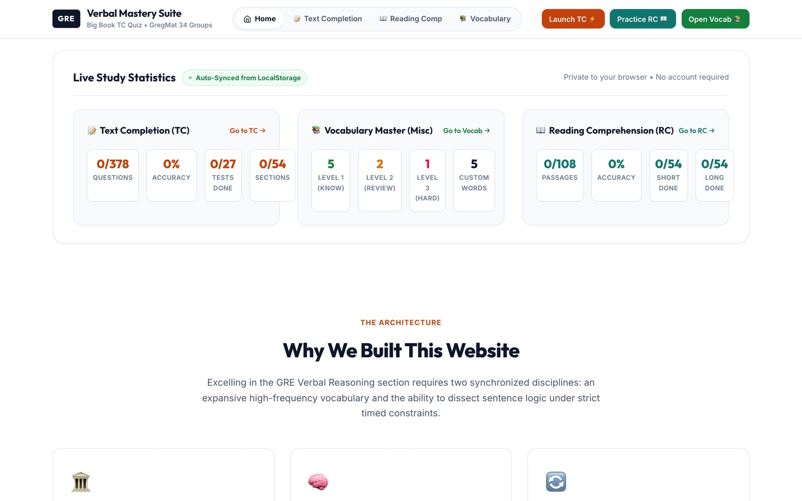
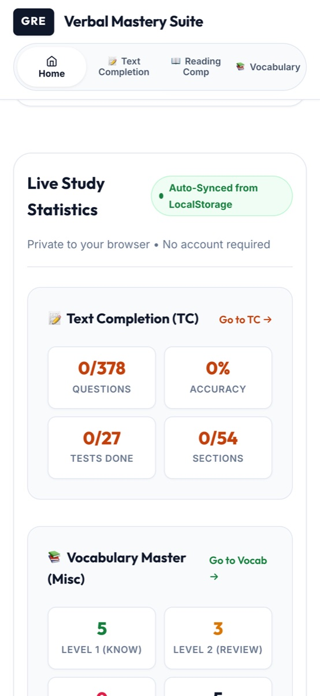
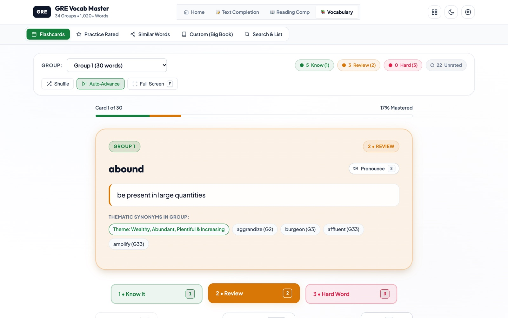
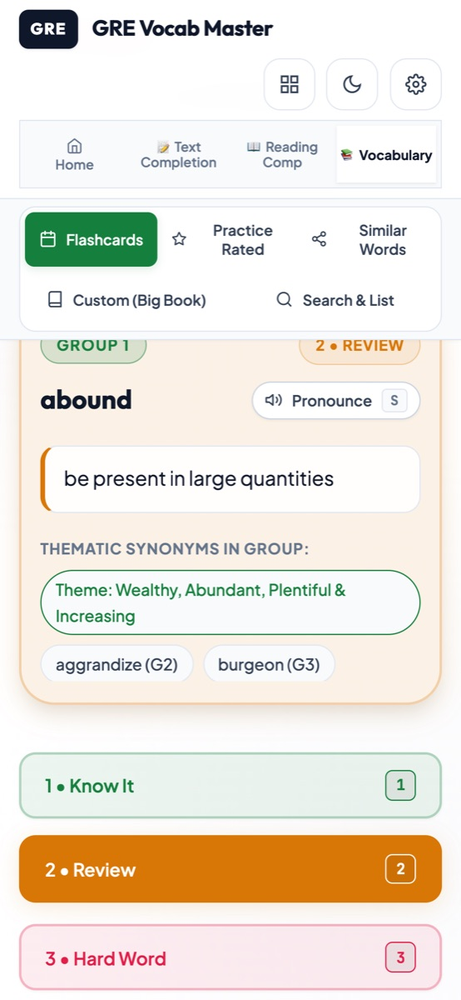
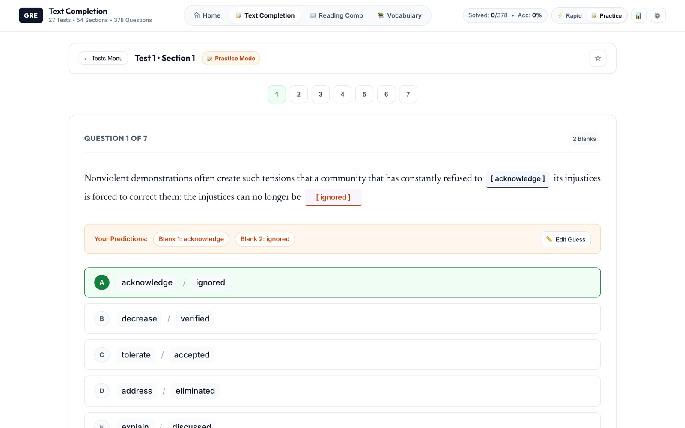
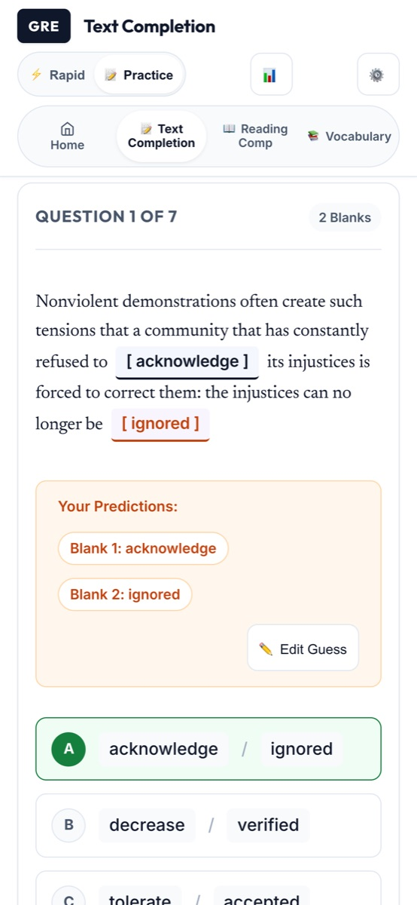
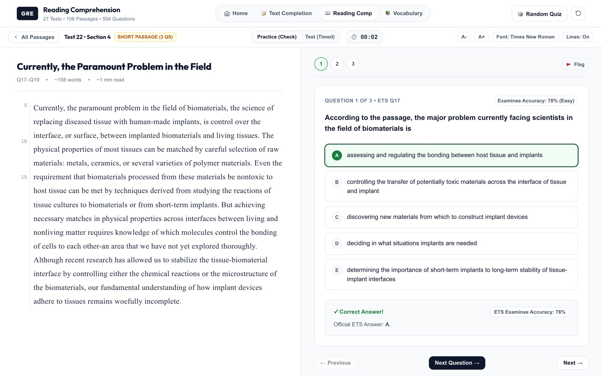
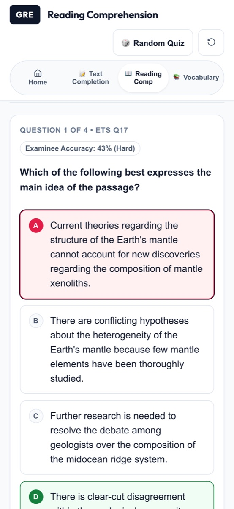
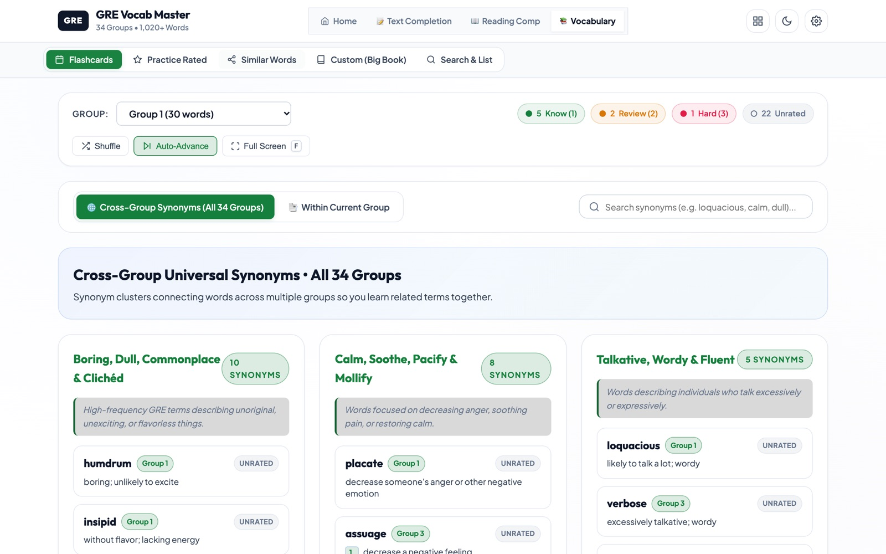
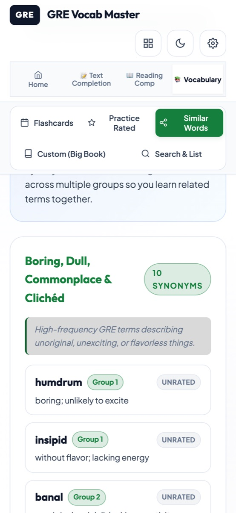

# 🎓 GRE Verbal Mastery Suite

A free, responsive GRE Verbal practice site with three modules: **GregMat's 34 Groups vocabulary** (1,020 words), **ETS GRE Big Book Text Completion** (378 questions) and **ETS GRE Big Book Reading Comprehension** (108 passages, 594 questions). It works on laptop and phone, with no account and no install.

[](https://sangameeee.github.io/GreFast/)


👉 **Live App:** [https://sangameeee.github.io/GRE-vocabulary-GregMat-34-Groups-1024-words-flashcard/](https://sangameeee.github.io/GRE-vocabulary-GregMat-34-Groups-1024-words-flashcard/)

---

> 💡 **Note:**  
> Most of the development for this application was done with AI. I built this tool for my own GRE preparation tailored to my personal study preferences and workflow.

---

## ✨ Features

### 🏠 Home hub
- One place to reach every module.
- A live study dashboard showing your progress across all three modules (questions solved, accuracy, tests and sections done, vocab ratings).

### 📚 Vocabulary: GregMat 34 Groups
- **1,020 words in 34 groups**, each with a definition and in-group synonym themes.
- **Flashcards** with flip, shuffle, auto-advance, full-screen focus mode and text-to-speech pronunciation.
- **1-2-3 ratings:** `1` Know it (green), `2` Review (orange), `3` Hard word (red).
- **Practice Rated:** drill only the words you rated 2 or 3.
- **Similar Words:** cross-group synonym clusters, so related words are learned together.
- **Custom (Big Book):** add your own words from mock tests or reading.
- **Search & List:** a searchable directory of every word.
- Dark/light theme, and JSON export/import of your progress.

### 📝 Text Completion: ETS GRE Big Book
- **27 tests, 54 sections, 378 questions** (one-, two- and three-blank).
- **Rapid mode:** timed drills with a configurable countdown.
- **Practice mode:** predict the blanks before the options are revealed.
- Per-test progress, accuracy tracking and an analytics panel.

### 📖 Reading Comprehension: ETS GRE Big Book
- **108 passages** (54 short, 54 long) with **594 questions**.
- A split-screen reader with line numbers, font-size and font controls.
- Practice (check each answer) and Test (timed) modes, question flags, and each question's examinee difficulty.
- Filter by short or long passages, or jump into a random quiz.

---

## 📸 Screenshots

Laptop (1440 × 900) on the left, phone (390 × 844) on the right.

### 1. Home hub and study dashboard
<table><tr>
<td width="72%"></td>
<td width="28%"></td>
</tr></table>

### 2. Vocabulary flashcards and ratings
<table><tr>
<td width="72%"></td>
<td width="28%"></td>
</tr></table>

### 3. Text Completion (Practice mode)
<table><tr>
<td width="72%"></td>
<td width="28%"></td>
</tr></table>

### 4. Reading Comprehension reader
<table><tr>
<td width="72%"></td>
<td width="28%"></td>
</tr></table>

### 5. Similar Words (cross-group synonym clusters)
<table><tr>
<td width="72%"></td>
<td width="28%"></td>
</tr></table>

---

## ⌨️ Keyboard Shortcuts (Vocabulary)

| Key | Action |
| --- | --- |
| `Space` | Flip card (Show / Hide definition) |
| `→` or `D` | Next card |
| `←` or `A` | Previous card |
| `1` | Rate word as **1 (Know It)** |
| `2` | Rate word as **2 (Review)** |
| `3` | Rate word as **3 (Hard Word)** |
| `S` | Pronounce word (Audio) |
| `F` | Toggle Focus Mode (distraction-free) |
| `?` | Show Shortcuts cheat sheet |

---

## ✅ Data Accuracy & Privacy

- **Answers verified:** every Text Completion and Reading Comprehension answer was checked against the official ETS Big Book answer keys.
- **Text cleaned:** scanning errors in passages, questions, choices and passage titles were corrected without changing the original wording.
- **Vocabulary checked:** the word list matches GregMat's 34 Groups, with a few definition fixes.
- **Private:** all ratings, custom words and quiz progress stay in your browser (`localStorage`). There is no account, tracking or server.

---

## 💻 Local Usage

1. Clone the repository:
   ```bash
   git clone git@github.com:Sangameeee/GRE-vocabulary-GregMat-34-Groups-1024-words-flashcard.git
   ```
2. Open [`index.html`](index.html) in any browser. There's no build step or server, and it works offline straight from your disk.

---

## 🗂️ Project Structure

```
index.html        Home hub and study dashboard
pages/            vocab.html, tc.html, rc.html
css/              Styles per page (responsive, light/dark)
js/               Page logic (vocab.js, tc.js, rc.js, home.js)
data/             Question and vocabulary datasets
images/           README screenshots
```
