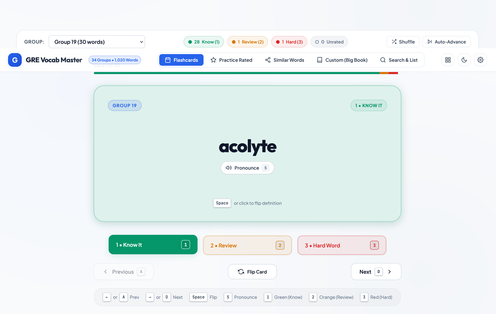
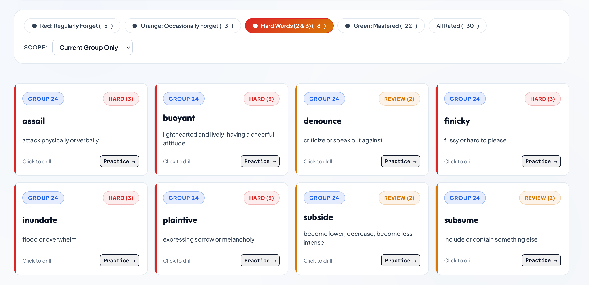
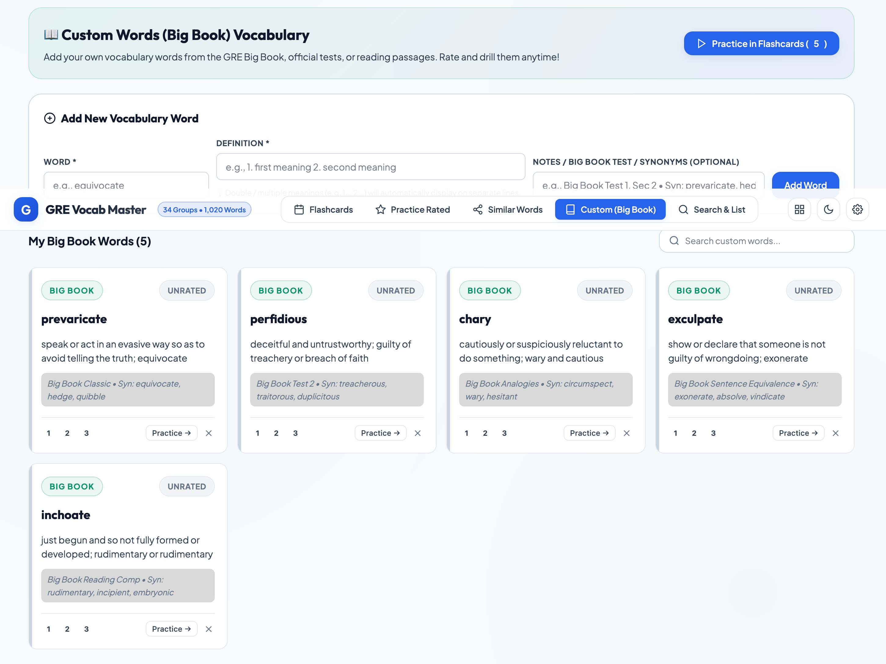

# 🎓 GRE Vocab Master (GregMat 34 Groups)

An interactive, responsive flashcard application built for mastering **GregMat's 34 Groups (1,020+ high-frequency GRE words)**, complete with custom word lists, memory ratings, and dedicated practice modes.

[](https://sangameeee.github.io/GRE-vocabulary-GregMat-34-Groups-1024-words-flashcard/)


👉 **Live App:** [https://sangameeee.github.io/GRE-vocabulary-GregMat-34-Groups-1024-words-flashcard/](https://sangameeee.github.io/GRE-vocabulary-GregMat-34-Groups-1024-words-flashcard/)

---

> 💡 **Note:**  
> Most of the development for this application was done with AI. I built this tool for my own GRE preparation tailored to my personal study preferences and workflow.

---

## ✨ Key Features

- **📚 34 Complete Word Groups**: 1,020+ curated GRE vocabulary words complete with definitions, parts of speech, and contextual example sentences.
- **⭐ 1-2-3 Rating System**:
  - `1`: Know it / Mastered (Green)
  - `2`: Need review / Occasionally forget (Orange)
  - `3`: Hard word / Regularly forget (Red)
- **🎯 Targeted Practice Modes**:
  - Drill down into specific ratings (e.g., review only your Level 2 & 3 words).
  - Synonym clusters and semantic groupings for pattern recognition.
- **📖 Big Book & Custom Lists**: Easily add, edit, and practice your own custom vocabulary words from official tests or reading passages.
- **🔊 Audio Pronunciation**: Built-in speech synthesis to listen to word pronunciations.
- **⌨️ Rich Keyboard Shortcuts**: Study without touching your mouse (`Space` to flip, `Arrow Keys` / `A` / `D` to navigate, `1`/`2`/`3` to rate, `S` to pronounce, `F` for focus mode).
- **🌗 Dark / Light Theme & Focus Mode**: Clean typography, distraction-free studying, and smooth animations.
- **💾 100% Offline & Private**: All ratings and custom words persist automatically in your browser (`localStorage`). No account or sign-in needed.
- **🔄 Export & Import**: Backup or transfer your study progress between devices using JSON export/import.

---

## ⌨️ Keyboard Shortcuts

| Key | Action |
| --- | --- |
| `Space` | Flip card (Show / Hide definition) |
| `→` or `D` | Next card |
| `←` or `A` | Previous card |
| `1` | Rate word as **1 (Know It)** |
| `2` | Rate word as **2 (Review)** |
| `3` | Rate word as **3 (Hard Word)** |
| `S` | Pronounce word (Audio) |
| `F` | Toggle Focus Mode (distraction-free) |
| `?` | Show Shortcuts cheat sheet |

---

## 📸 Screenshots & Demos

### 1. Flashcards & Interactive Rating
Master each group with confidence indicators, text-to-speech pronunciation, and quick rating buttons (`1 • Know It`, `2 • Review`, `3 • Hard Word`).



---

### 2. Practice Rated Words & Targeted Drill
Filter words based on your personal rating: focus on words you regularly forget (Red), occasionally forget (Orange), or drill all difficult words together.



---

### 3. Custom Words & Big Book Vocabulary
Add your own custom words from the GRE Big Book, mock tests, or reading passages with custom notes, synonyms, and test references.



---

## 💻 Local Usage

You can also run this locally on your computer:
1. Clone the repository:
   ```bash
   git clone git@github.com:Sangameeee/GRE-vocabulary-GregMat-34-Groups-1024-words-flashcard.git
   ```
2. Double-click [`index.html`](index.html) to open in any web browser — no build steps or server setup needed.
